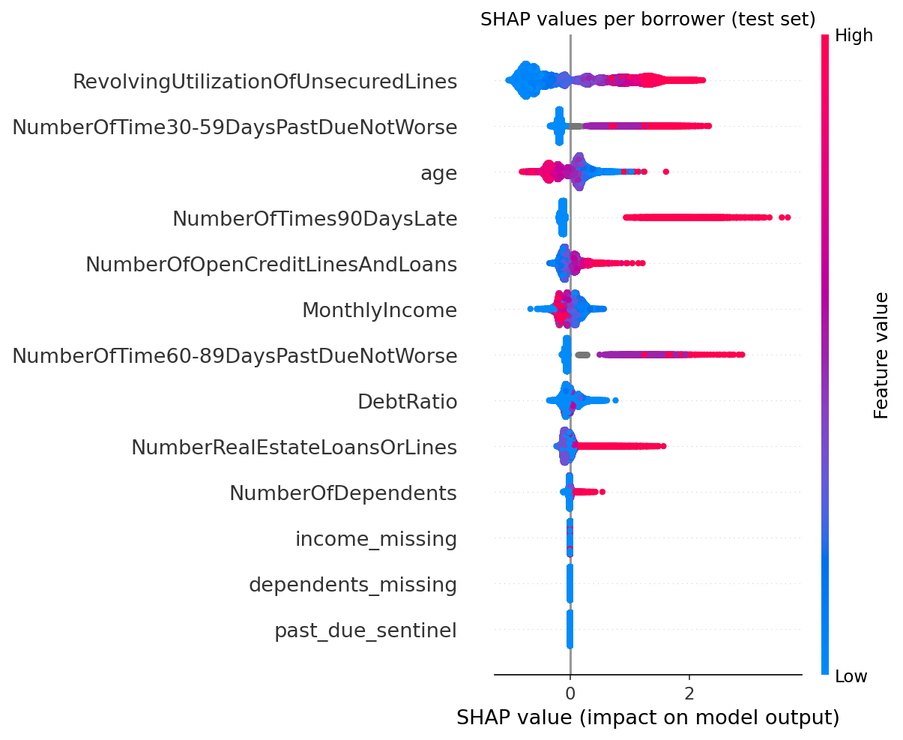

# Credit Risk: Default Prediction



Predicts whether a borrower will be **90+ days past due within the next 2 years**, and turns the score into an approval policy.

**From machine failure to loan default.** I come from industrial IoT and predictive maintenance. A loan default behaves like a machine failure: it is rare, the data is imbalanced, and a missed event costs much more than a false alarm. This project applies the same reasoning to credit risk.

## Results

| Model | ROC-AUC | PR-AUC |
|---|---|---|
| Random scores | 0.50 | 0.067 |
| Logistic regression (baseline) | 0.860 | 0.398 |
| **LightGBM (final)** | **0.868** | **0.409** |

All metrics on the same held-out test set (30,000 borrowers, 6.7% default rate). PR-AUC is the main metric because defaults are rare.

**Business impact:** approving 80% of applicants rejects the riskiest 20% and avoids **72.8% of all defaults (1,460 of 2,005)**. The default rate among approved borrowers drops from 6.7% to **2.3%**. The cutoff was chosen on out-of-fold scores from the training set and applied once to the test set.

## Key findings

* **Behavior matters more than profile.** Credit card utilization and past-due history drive most of the risk. Income and number of dependents have a small effect.
* **The two models agree** on the main risk drivers (utilization, past-due counts, age, income), which suggests the pattern is in the data and not an artifact of one model.
* **Most of the gain came from data preparation.** A well-prepared logistic regression was already close. LightGBM added a small but consistent improvement.
* **More trees made it worse.** 500 fixed trees only matched the baseline. Early stopping in cross-validation found that about 120 were enough.
* **`DebtRatio` hides two variables.** When income is missing, the column stores the debt amount instead of a ratio. Split by group, the ratio shows the expected pattern: risk rises above about 50% of income committed. This explains the counterintuitive negative coefficient in the logistic regression.
* **Missing data is handled differently by each model.** The logistic regression needed explicit missing-value flags. LightGBM used the missing values directly and predicted the rare sentinel group (54.5% actual default rate) at 53.9%.

## Project structure

```
notebooks/
├── 01_eda.ipynb             # Data quality, imbalance, first patterns
├── 02_baseline.ipynb        # Data preparation + logistic regression
├── 03_lightgbm.ipynb        # LightGBM with cross-validation, logged to MLflow
└── 04_shap_business.ipynb   # SHAP explanations + approval cutoff
images/                      # Figures used in this README
```

Each notebook ends with a findings section that feeds the next one.

## Data

[Give Me Some Credit](https://www.kaggle.com/c/GiveMeSomeCredit) (Kaggle), 150,000 borrowers.
Target: `SeriousDlqin2yrs`.

Data is **not versioned in this repo**. It is stored in a Databricks Unity Catalog Volume:
`/Volumes/workspace/risco_credito/raw/cs-training.csv`

## Method

1. **EDA:** missing values (income ~20%), invalid ages, sentinel codes 96/98 in past-due columns, extreme outliers in utilization and debt ratio.
2. **Baseline:** stratified 80/20 split, median imputation + missing flags, p99 clipping, standard scaling, logistic regression. All statistics fitted on train only.
3. **LightGBM:** same split and flags, no imputation or scaling. Number of trees chosen with early stopping in 5-fold stratified CV. Test set used once. Final model logged to MLflow.
4. **Explainability and business:** SHAP (TreeExplainer) for global importance and feature effects. Approval cutoff chosen on out-of-fold train scores, then evaluated on test.

## Stack

Databricks Free Edition · Python · pandas · scikit-learn · LightGBM · SHAP · MLflow · matplotlib

## How to run

1. Download `cs-training.csv` from Kaggle and upload it to a Databricks Volume.
2. Update `PATH` at the top of each notebook if your Volume path is different.
3. Run the notebooks in order. `04_shap_business` loads the model from MLflow, so set `RUN_ID` to your run from `03_lightgbm`.

## Possible improvements

* Split `DebtRatio` into a ratio (NaN when income is missing) and a debt amount feature.
* Move the shared data preparation into a `src/` module instead of repeating it in each notebook.
* Tune LightGBM hyperparameters beyond the number of trees.
* Choose the cutoff from the cost of a default vs. the profit of a good loan, instead of a fixed approval rate.

## Conventions

Commit messages follow [Conventional Commits](https://www.conventionalcommits.org/) (`feat`, `fix`, `docs`, `refactor`, `chore`).
